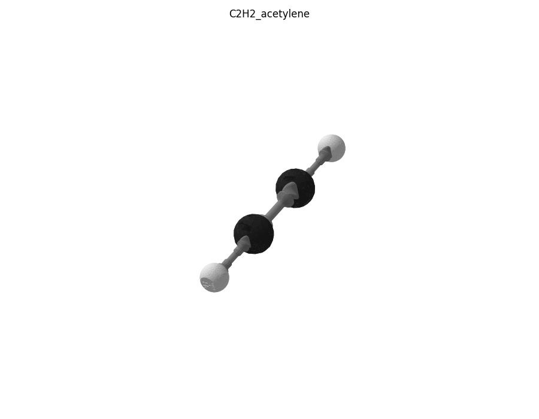

# Ацетилен C₂H₂

Файлы `C2H2_acetylene.glb` (Blender), `C2H2_acetylene.usdz` (iPhone AR) и `plates/` (пластины по цветам) входят в ассет релиза `chem_constructor_v1.0_molecules_models.zip`, см. [docs/RELEASE.md](../../docs/RELEASE.md).

## Детали

| Деталь | Кол-во |
|---|---|
| C (углерод) | 2 |
| C–H | 2 |
| H (водород) | 2 |
| C≡C | 1 |
| **всего** | **7** |

## Пластины для печати

| Файл | Филамент | Состав |
|---|---|---|
| `plates/black_PLA_carbon.3mf` | PLA чёрный | C (углерод)×2 |
| `plates/gray_PETG_nonpolar_bonds.3mf` | PETG серый | C≡C×1, C–H×2 |
| `plates/white_PLA_hydrogen.3mf` | PLA белый | H (водород)×2 |

## Сборка

Каждую связь вставлять в паз и ввинчивать **по часовой стрелке** (если смотреть на атом), до щелчка защёлки. Атомы нумеруются по порядку сборки (C1, C2, …). Названия пазов углерода — см. общий README, раздел «Пазы углерода».

- связь **C≡C**: в паз **тройной** атома **C1**; на свободный конец — **C** пазом *тройной*
  - связь **C–H**: в паз **T1** атома **C2**; на свободный конец — **H** пазом *паз*
- связь **C–H**: в паз **T1** атома **C1**; на свободный конец — **H** пазом *паз*

Проверено булевой сборкой из печатных STL: пересечений деталей нет.