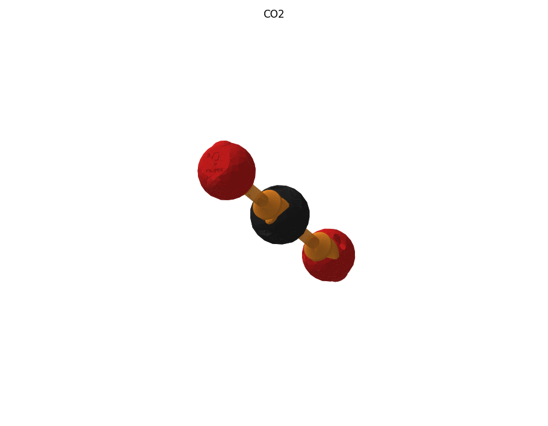

# Углекислый газ CO₂

Файлы `CO2.glb` (Blender), `CO2.usdz` (iPhone AR) и `plates/` (пластины по цветам) входят в ассет релиза `chem_constructor_v1.0_molecules_models.zip`, см. [docs/RELEASE.md](../../docs/RELEASE.md).

## Детали

| Деталь | Кол-во |
|---|---|
| C=O | 2 |
| O (кислород) | 2 |
| C (углерод) | 1 |
| **всего** | **5** |

## Пластины для печати

| Файл | Филамент | Состав |
|---|---|---|
| `plates/black_PLA_carbon.3mf` | PLA чёрный | C (углерод)×1 |
| `plates/orange_PETG_polar_bonds.3mf` | PETG оранжевый | C=O×2 |
| `plates/red_PLA_oxygen.3mf` | PLA красный | O (кислород)×2 |

## Сборка

Каждую связь вставлять в паз и ввинчивать **по часовой стрелке** (если смотреть на атом), до щелчка защёлки. Атомы нумеруются по порядку сборки (C1, C2, …). Названия пазов углерода — см. общий README, раздел «Пазы углерода».

- связь **C=O**: в паз **Д1 (двойной)** атома **C1**; на свободный конец — **O** пазом *двойной*
- связь **C=O**: в паз **Д2 (двойной)** атома **C1**; на свободный конец — **O** пазом *двойной*

Проверено булевой сборкой из печатных STL: пересечений деталей нет.