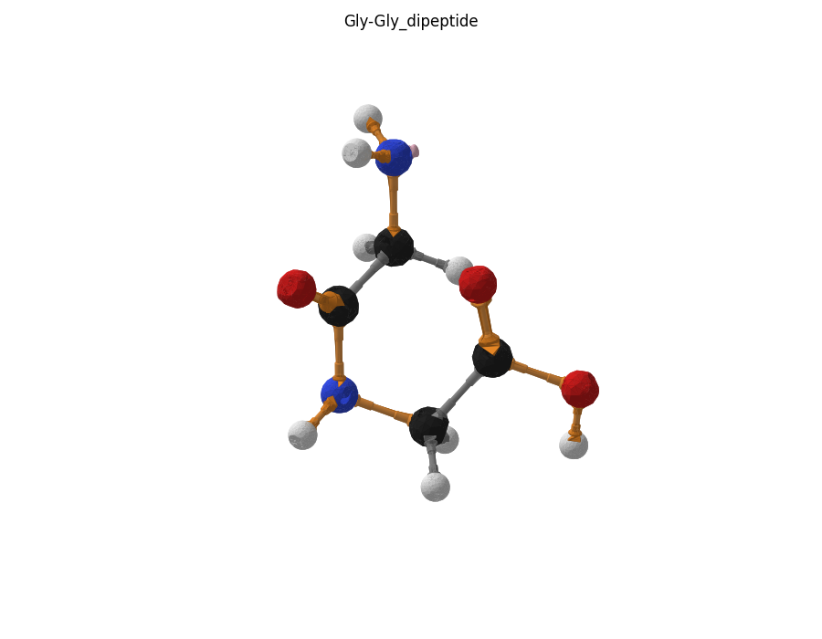

# Дипептид глицил-глицин (Gly-Gly)

Файлы `Gly-Gly_dipeptide.glb` (Blender), `Gly-Gly_dipeptide.usdz` (iPhone AR) и `plates/` (пластины по цветам) входят в ассет релиза `chem_constructor_v1.0_molecules_models.zip`, см. [docs/RELEASE.md](../../docs/RELEASE.md).

## Детали

| Деталь | Кол-во |
|---|---|
| H (водород) | 8 |
| C (углерод) | 4 |
| C–H | 4 |
| C–N | 3 |
| N–H | 3 |
| O (кислород) | 3 |
| N (азот) | 2 |
| заглушка неподелённой пары | 2 |
| C–C | 2 |
| C=O | 2 |
| C–O | 1 |
| O–H | 1 |
| **всего** | **35** |

## Пластины для печати

| Файл | Филамент | Состав |
|---|---|---|
| `plates/black_PLA_carbon.3mf` | PLA чёрный | C (углерод)×4 |
| `plates/orange_PETG_polar_bonds.3mf` | PETG оранжевый | C–N×3, N–H×3, C=O×2, C–O×1, O–H×1 |
| `plates/blue_PLA_nitrogen.3mf` | PLA синий | N (азот)×2 |
| `plates/white_PLA_hydrogen.3mf` | PLA белый | H (водород)×8 |
| `plates/pink_PLA_caps.3mf` | PLA розовый (или белый) | заглушка неподелённой пары×2 |
| `plates/gray_PETG_nonpolar_bonds.3mf` | PETG серый | C–C×2, C–H×4 |
| `plates/red_PLA_oxygen.3mf` | PLA красный | O (кислород)×3 |

## Сборка

Каждую связь вставлять в паз и ввинчивать **по часовой стрелке** (если смотреть на атом), до щелчка защёлки. Атомы нумеруются по порядку сборки (C1, C2, …). Названия пазов углерода — см. общий README, раздел «Пазы углерода».

- связь **C–N**: в паз **T0** атома **C1**; на свободный конец — **N** пазом *одинарный 1*
  - связь **N–H**: в паз **одинарный 2** атома **N1**; на свободный конец — **H** пазом *паз*
  - связь **N–H**: в паз **одинарный 3** атома **N1**; на свободный конец — **H** пазом *паз*
  - заглушку неподелённой пары — в паз заглушки атома **N1**
- связь **C–C**: в паз **T1** атома **C1**; на свободный конец — **C** пазом *T0*
  - связь **C=O**: в паз **Д1 (двойной)** атома **C2**; на свободный конец — **O** пазом *двойной*
  - связь **C–N**: в паз **T1** атома **C2**; на свободный конец — **N** пазом *одинарный 1*
    - связь **N–H**: в паз **одинарный 2** атома **N2**; на свободный конец — **H** пазом *паз*
    - связь **C–N**: в паз **одинарный 3** атома **N2**; на свободный конец — **C** пазом *T0*
      - связь **C–C**: в паз **T1** атома **C3**; на свободный конец — **C** пазом *T0*
        - связь **C=O**: в паз **Д1 (двойной)** атома **C4**; на свободный конец — **O** пазом *двойной*
        - связь **C–O**: в паз **T1** атома **C4**; на свободный конец — **O** пазом *одинарный 1*
          - связь **O–H**: в паз **одинарный 2** атома **O3**; на свободный конец — **H** пазом *паз*
      - связь **C–H**: в паз **T2** атома **C3**; на свободный конец — **H** пазом *паз*
      - связь **C–H**: в паз **T3** атома **C3**; на свободный конец — **H** пазом *паз*
    - заглушку неподелённой пары — в паз заглушки атома **N2**
- связь **C–H**: в паз **T2** атома **C1**; на свободный конец — **H** пазом *паз*
- связь **C–H**: в паз **T3** атома **C1**; на свободный конец — **H** пазом *паз*

Проверено булевой сборкой из печатных STL: пересечений деталей нет.