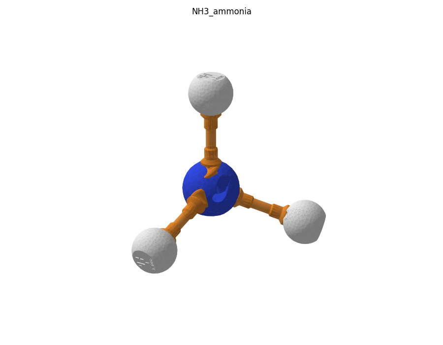

# Аммиак NH₃

Файлы `NH3_ammonia.glb` (Blender), `NH3_ammonia.usdz` (iPhone AR) и `plates/` (пластины по цветам) входят в ассет релиза `chem_constructor_v1.0_molecules_models.zip`, см. [docs/RELEASE.md](../../docs/RELEASE.md).

## Детали

| Деталь | Кол-во |
|---|---|
| N–H | 3 |
| H (водород) | 3 |
| N (азот) | 1 |
| заглушка неподелённой пары | 1 |
| **всего** | **8** |

## Пластины для печати

| Файл | Филамент | Состав |
|---|---|---|
| `plates/blue_PLA_nitrogen.3mf` | PLA синий | N (азот)×1 |
| `plates/orange_PETG_polar_bonds.3mf` | PETG оранжевый | N–H×3 |
| `plates/white_PLA_hydrogen.3mf` | PLA белый | H (водород)×3 |
| `plates/pink_PLA_caps.3mf` | PLA розовый (или белый) | заглушка неподелённой пары×1 |

## Сборка

Каждую связь вставлять в паз и ввинчивать **по часовой стрелке** (если смотреть на атом), до щелчка защёлки. Атомы нумеруются по порядку сборки (C1, C2, …). Названия пазов углерода — см. общий README, раздел «Пазы углерода».

- связь **N–H**: в паз **одинарный 1** атома **N1**; на свободный конец — **H** пазом *паз*
- связь **N–H**: в паз **одинарный 2** атома **N1**; на свободный конец — **H** пазом *паз*
- связь **N–H**: в паз **одинарный 3** атома **N1**; на свободный конец — **H** пазом *паз*
- заглушку неподелённой пары — в паз заглушки атома **N1**

Проверено булевой сборкой из печатных STL: пересечений деталей нет.